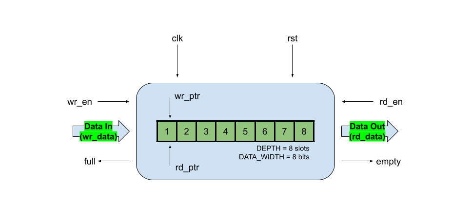
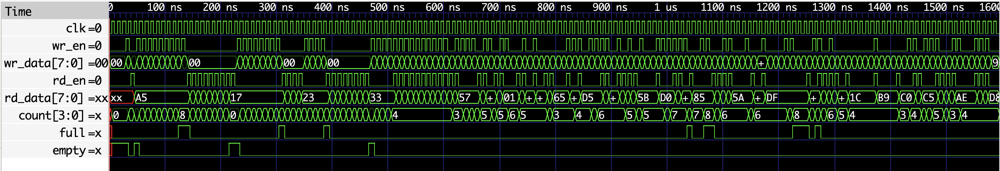

# Synchronous FIFO in Verilog

## Architecture



## What is it?

A synchronous FIFO is a hardware queue that follows the **First In, First Out
(FIFO)** rule: the first data written is the first data read. It uses one clock.
Accepted writes and reads happen on the rising edge of that clock.

## Why is it important?

Two parts of a chip can produce and consume data at different times. A FIFO
holds data between them, so a short delay on one side does not immediately stop
the other side.

### CPU example

A FIFO can sit between two CPU pipeline stages. If the next stage is busy, the
FIFO holds the earlier stage's results until the next stage is ready.

### GPU example

A FIFO can hold commands or work waiting for a GPU processing unit. The GPU
takes work from the queue as it becomes available.

Real CPUs and GPUs have many kinds of queues. Some can prioritize or reorder
work, so they are not all strict FIFOs.

## This implementation

The design in [`rtl/sync_fifo.v`](rtl/sync_fifo.v) has a data width of 8 bits
and a depth of 8 entries by default. It contains:

- **Memory:** Stores the data words.
- **ADDR_WIDTH:** The number of bits needed to address the memory entries.
- **wr_ptr:** Selects where the next accepted write goes.
- **rd_ptr:** Selects the oldest stored word to read.
- **count:** Tracks how many words are stored. It determines the `empty` and
  `full` flags.

The pointers wrap back to zero at the end of the memory. A write is accepted
when `wr_en` is on and the FIFO is not full. A read is accepted when `rd_en` is
on and the FIFO is not empty. Read data appears on `rd_data` after the rising
clock edge. The reset `rst` is active-high and synchronous.

## Full-Empty Trap

The read and write pointers can have the same address when the FIFO is empty or
full. The addresses alone cannot tell which state it is in.

This design uses a **count** to tell the difference:

- `count == 0` means empty.
- `count == DEPTH` means full.
- A write without a read increases the count.
- A read without a write decreases the count.
- If both or neither happen, the count stays the same.

This design does **not** use the alternative extra-pointer-bit method. The
pointers are only `ADDR_WIDTH` bits wide.

## Simulate

Run these commands from the project directory:

```sh
iverilog -g2012 -Wall -o sim rtl/sync_fifo.v tb/sync_fifo_tb.v
vvp sim
gtkwave sync_fifo.vcd
```

The testbench checks reset, FIFO ordering, full and empty behavior, pointer
wraparound, simultaneous reads and writes, and random transfers.

## Waveform

The waveform shows a part of the FIFO signals changing during simulation. Open
`sync_fifo.vcd` in GTKWave to inspect the signals cycle by cycle.


